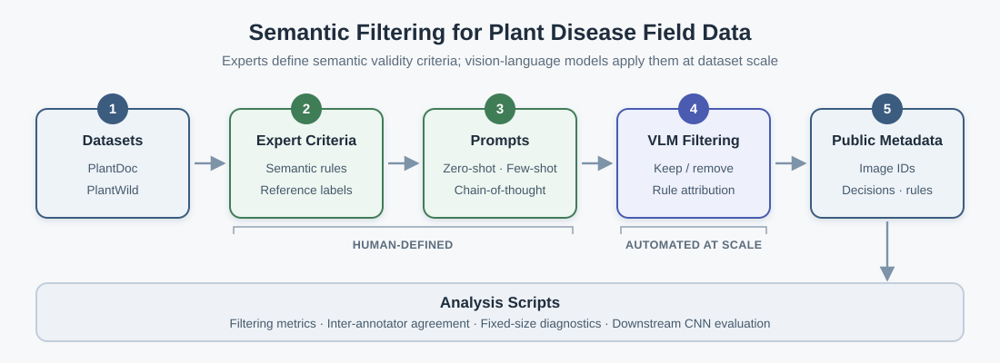

# Semantic Filtering for Plant Disease Field Data

This repository provides code, prompt templates, expert-defined filtering rules, and sanitized filtering metadata for the manuscript:

**Toward Ensuring the Quality of Plant Disease Field Data for Robust Deep Learning: Noise Removal through Semantic Filtering**

The project studies semantic noise in real-world plant disease field datasets. Domain experts define semantic validity criteria, and vision-language models (VLMs) apply those criteria at dataset scale. The goal is not to replace expert judgment, but to make expert-defined data curation more scalable, auditable, and reproducible.



## Repository contents

```text
scripts/          Analysis scripts (filtering, metrics, IAA, fixed-size subset, training)
metadata/         Sanitized per-image filtering metadata
prompts/          Expert filtering rules and prompt templates
docs/             Dataset sources, experiment overview, and workflow diagram
data/             Notes on local dataset layout
requirements.txt  Python dependencies
LICENSE           Code license (CC BY-NC-ND 4.0)
LICENSE-DATA.md   Data and documentation license (CC BY-NC 4.0)
```

Raw images, API keys, and bulk outputs are not part of this repository; see `.gitignore`.

## Dataset sources

Raw images must be obtained from the original dataset sources:

- PlantDoc: https://github.com/pratikkayal/PlantDoc-Dataset
- PlantWild: https://huggingface.co/datasets/uqtwei2/PlantWild

Citation details and usage notes are provided in `docs/DATASETS.md`.

## Public metadata

The `metadata/` directory contains sanitized per-image filtering metadata:

```text
metadata/expert_reference_metadata.csv
metadata/vlm_filtering_metadata.csv
```

These files include image identifiers, class labels, expert reference decisions, VLM keep/remove decisions, prompt condition, model name, and rule attribution. They do not include raw images, local paths, full VLM natural-language responses, or API outputs.

The VLM metadata covers 2 datasets, 6 VLM configurations, and 3 prompt styles:

| Dimension | Values | Count |
|---|---|---:|
| Datasets | `plantdoc`, `plantwild` | 2 |
| Models | `gpt-4o-mini`, `gpt-4o`, `gemini-2.0-flash-lite`, `gemini-2.5-flash`, `claude-sonnet-4-6`, `claude-haiku-4-5-20251001` | 6 |
| Prompts | `zero_shot`, `few_shots`, `cot` | 3 |

The metadata contains `3,000 images x 6 models x 3 prompts = 54,000` VLM decision rows.

See `metadata/README.md` for the exact columns and decision encoding.

## Main workflow

1. Download PlantDoc and PlantWild from their original sources.
2. Prepare local CSV manifests with image paths and class labels.
3. Review the expert-defined semantic filtering rules in `prompts/filtering_rules.md`.
4. Run VLM filtering with one of the templates in `prompts/prompt_templates.md`.
5. Compare VLM decisions with expert reference labels.
6. Train downstream CNN classifiers on retained subsets.
7. Build fixed-size diagnostic subsets when retained-data volume must be controlled.
8. Compute inter-annotator agreement for expert reference labels.

## Installation

```bash
python3 -m venv .venv
source .venv/bin/activate
pip install -r requirements.txt
```

## Expected CSV formats

For VLM filtering:

```text
img_path,class_name
```

For downstream classifier training:

```text
img_path,class_name,label
```

For filtering metric computation:

```text
shared image identifier,expert_decision,vlm_decision
```

Decisions are encoded as `keep` or `remove`. The shared identifier is `img_path`
for local manifests or `image_id` for the released metadata. Column names are
configurable through `--id_col`, `--pred_col`, and `--ref_col`.

## Example commands

Run VLM filtering:

```bash
python scripts/run_vlm_filtering.py \
  --input_csv data/processed/plantdoc_manifest.csv \
  --output_csv outputs/plantdoc_gpt4omini_cot.csv \
  --prompt_txt prompts/prompt_templates.md \
  --provider openai \
  --model gpt-4o-mini \
  --temperature 0.0
```

Compute filtering metrics:

```bash
python scripts/compute_filtering_metrics.py \
  --pred_csv outputs/plantdoc_gpt4omini_cot.csv \
  --ref_csv data/processed/plantdoc_expert_reference.csv \
  --id_col img_path \
  --pred_col vlm_decision \
  --ref_col expert_decision \
  --output_csv outputs/filtering_metrics.csv
```

To compute metrics directly from the released metadata, first select one model
and prompt from `metadata/vlm_filtering_metadata.csv` (which already contains
both `expert_decision` and `vlm_decision`), then pass that file with
`--id_col image_id --pred_col vlm_decision --ref_col expert_decision`.

Create a fixed-size diagnostic subset:

```bash
python scripts/make_fixed_size_subset.py \
  --input_csv data/processed/plantdoc_train_pool.csv \
  --target_n 650 \
  --seed 0 \
  --output_csv outputs/plantdoc_fixed_n650_seed0.csv
```

Train a downstream classifier:

```bash
python scripts/train_downstream_classifier.py \
  --train_csv data/processed/plantdoc_train.csv \
  --test_csv data/processed/plantdoc_test.csv \
  --arch resnet50 \
  --seed 0 \
  --epochs 30 \
  --output_json outputs/plantdoc_resnet50_seed0.json
```

## Scripts

| Script | Purpose | Main input | Main output |
|---|---|---|---|
| `scripts/run_vlm_filtering.py` | Apply VLM semantic filtering to an image manifest using a prompt template | Image manifest CSV, prompt template, provider, model | Parsed `keep`/`remove` decision and rule (`vlm_decision`, `vlm_rule`) in a local output CSV |
| `scripts/compute_filtering_metrics.py` | Compute binary keep/remove filtering metrics against expert reference labels | Prediction CSV and reference CSV joined on a shared identifier | CSV with accuracy, precision, recall, F1, and Cohen's kappa |
| `scripts/compute_iaa.py` | Compute inter-annotator agreement for binary keep/remove labels | CSV with two annotator decision columns | CSV with agreement rate and Cohen's kappa |
| `scripts/make_fixed_size_subset.py` | Create a stratified fixed-size subset from a manifest | Manifest CSV, target size, seed | Subset CSV of the requested size |
| `scripts/train_downstream_classifier.py` | Train a downstream CNN classifier from manifests | Train and test manifest CSVs, architecture, seed, epochs | JSON file of evaluation metrics |

## API keys and safety

API keys are not included. If you run VLM filtering, set keys in your shell:

```bash
export OPENAI_API_KEY=...
export GOOGLE_API_KEY=...
export ANTHROPIC_API_KEY=...
```

Do not commit API keys, raw images, local image paths, full VLM responses, API
logs, model checkpoints, or generated bulk outputs. The included `.gitignore`
is configured to exclude these files by default.

## License

The original source code is licensed under [Creative Commons Attribution-NonCommercial-NoDerivatives 4.0 International
(CC BY-NC-ND 4.0)](LICENSE). The
metadata, prompt files, and documentation are released under Creative Commons
Attribution-NonCommercial 4.0 International (CC BY-NC 4.0; see
`LICENSE-DATA.md`).

Raw images are not included. Please download PlantDoc and PlantWild from their
original sources listed in `docs/DATASETS.md`.

## Citation

If you reference, reproduce, or build on this work in academic research, please
cite the accompanying manuscript:

> Yu Sung Edward Kim, Willmer Rafell Quinones Robles, Fania Ardelia Devira, and
> Mun Yong Yi. Toward Ensuring the Quality of Plant Disease Field Data for Robust
> Deep Learning: Noise Removal through Semantic Filtering.

Please also cite the original PlantDoc and PlantWild datasets listed in
`docs/DATASETS.md`.

Copyright 2026 The semantic-filtering authors

Appropriate attribution is required. Noncommercial use and redistribution of
the unadapted material are permitted; sharing adapted material is not permitted.
Noncommercial modifications for private use are permitted. The complete standard
terms, including exceptions and limitations, are in [LICENSE](LICENSE) and the
[official legal code](https://creativecommons.org/licenses/by-nc-nd/4.0/legalcode.en).
