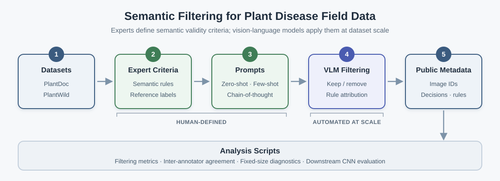

# Semantic Filtering for Plant Disease Field Data

This repository provides code, prompt templates, expert-defined filtering rules, and sanitized filtering metadata for the manuscript:

**Toward Ensuring the Quality of Plant Disease Field Data for Robust Deep Learning: Noise Removal through Semantic Filtering**

The project studies semantic noise in real-world plant disease field datasets. Domain experts define semantic validity criteria, and vision-language models (VLMs) apply those criteria at dataset scale. The goal is not to replace expert judgment, but to make expert-defined data curation more scalable, auditable, and reproducible.



## Repository contents

```text
manifests/        Split manifest: every training-pool and test image with source path and SHA-256
metadata/         Expert reference labels, every VLM decision with its cited rule, and the comparator decisions
prompts/          Expert filtering rules, prompt summaries, and verbatim prompts (prompts/verbatim/)
audits/           Exact-duplicate audit between test sets and training pools
downstream/       Seed-level downstream results of every training condition and the class order of the predictions
predictions/      Per-image test predictions of every downstream run, keyed by the manifest image_id
summaries/        Filter-level and downstream summary results reported in the article
scripts/          Analysis scripts and the scripts that reproduce the filter-level, rule-level, and downstream results
docs/             Dataset sources, models and access dates, experiment overview, workflow diagram
data/             Notes on local dataset layout
requirements.txt  Python dependencies
LICENSE           Code license (CC BY-NC-ND 4.0)
LICENSE-DATA.md   Data and documentation license (CC BY-NC 4.0)
```

Raw images, API keys, and bulk outputs are not part of this repository; see `.gitignore`.

## Dataset sources

Raw images must be obtained from the original dataset sources:

- PlantDoc: https://github.com/pratikkayal/PlantDoc-Dataset
- PlantWild: https://huggingface.co/datasets/uqtwei2/PlantWild

Citation details and usage notes are provided in `docs/DATASETS.md`.

## Public metadata

The `metadata/` directory contains decision-level metadata:

```text
metadata/expert_reference_metadata.csv   3,000 training-pool images with the expert reference decision and rule
metadata/vlm_filtering_metadata.csv      93,000 VLM decisions (image x model x prompt condition)
metadata/comparator_decisions.csv        15,000 keep/remove decisions of the five automatic comparators
```

The VLM metadata covers six models (`gpt-4o-mini`, `gpt-4o`, `gemini-2.0-flash-lite`, `gemini-2.5-flash`, `claude-sonnet-4-6`, `claude-haiku-4-5-20251001`) with the zero-shot, few-shot, and chain-of-thought prompts, together with the comparators and ablations of the article: rule-free prompts, self-consistency, repeated runs, reversed rule order, and two and three exemplars per category. The files include image identifiers, class labels, expert and VLM decisions, and rule attribution. They do not include raw images, local paths, or full natural-language model responses. See `metadata/README.md` for the columns and conditions, `prompts/verbatim/` for the exact prompts, and `docs/MODELS.md` for model identifiers and access dates.

`manifests/split_manifest.csv` maps every `image_id` to its path in the original dataset release and to the SHA-256 checksum of the file, and flags the curated test images and the few-shot exemplars.

## Reproducing the article results

All filter-level results of the article (Cohen's kappa, precision, recall, rule attribution, medians over configurations) can be recomputed from the released files without querying any model:

```bash
python scripts/reproduce_filter_tables.py
```

The script checks every value against `summaries/filter_metrics.csv`.

The rule-level analysis (the share of each kind of expert-defined noise that every VLM configuration and comparator
detects, and the images on which most configurations disagree with the experts) can be recomputed from the released
decisions in the same way:

```bash
python scripts/reproduce_rule_detection.py
```

The script checks every value against `summaries/rule_detection.csv`.

Offline regression checks for the Table 8 selection, per-image request contents, and final-decision parsing:

```bash
python -m unittest discover -s tests
```

All downstream results (accuracy over seeds, bootstrap confidence intervals, exact paired sign-flip tests against
unfiltered training with Holm correction, the analyses without duplicated test images, and the distribution over VLM
configurations) can be recomputed from the released predictions:

```bash
python scripts/reproduce_downstream_tables.py
```

The script checks every value against `summaries/downstream_conditions.csv` and prints the summary rows of the
downstream tables. The released files are:

```text
downstream/seed_results.csv                 1,930 runs (386 conditions x 5 seeds): accuracy, macro-F1, AUROC, AUPRC,
                                            uncurated-test accuracy, training and validation sizes, in_summaries flag
downstream/class_order.json                 class order of the probability vectors, per dataset
predictions/plantdoc_test_predictions.csv.gz    per-image predictions on the curated and uncurated test sets
predictions/plantwild_test_predictions.csv.gz   (condition, seed, test_set, image_id, true_class, pred_class, probs)
summaries/downstream_conditions.csv         one row per condition with confidence intervals and paired tests
summaries/vlm_distribution.csv              distribution over VLM configurations per dataset, classifier, and setting
summaries/kappa_selected.csv                the configuration selected by kappa on the training pool, all settings
summaries/classwise.csv                     per-class recall of every natural-setting condition
summaries/audit_sample.csv                  audit-sample simulation (python scripts/simulate_audit_sample.py)
```

A condition name encodes the dataset, the filter (`bsl_<method>` for comparators, `<model>_<prompt>` for VLM filters),
the classifier, and, for the fixed-size setting, the training-set size (`_N650`). Conditions with `in_summaries`
false are reported for completeness but excluded from all summaries (the Gemini few-shot runs with incorrectly
labeled exemplars).

## Main workflow

1. Download PlantDoc and PlantWild from their original sources.
2. Prepare local CSV manifests with image paths and class labels.
3. Review the expert-defined semantic filtering rules in `prompts/filtering_rules.md`.
4. Run VLM filtering with the model's verbatim prompt in `prompts/verbatim/` (see its README for the mapping).
5. Compare VLM decisions with expert reference labels.
6. Train downstream classifiers on retained subsets.
7. Build fixed-size diagnostic subsets when retained-data volume must be controlled.
8. Compute inter-annotator agreement for expert reference labels.

## Installation

```bash
python3 -m venv .venv
source .venv/bin/activate
pip install -r requirements.txt
```

## Expected CSV formats

For VLM filtering:

```text
img_path,class_name
```

For downstream classifier training:

```text
img_path,class_name,label
```

For filtering metric computation:

```text
shared image identifier,expert_decision,vlm_decision
```

Decisions are encoded as `keep` or `remove`. The shared identifier is `img_path`
for local manifests or `image_id` for the released metadata. Column names are
configurable through `--id_col`, `--pred_col`, and `--ref_col`.

## Example commands

Run VLM filtering with the verbatim GPT-4o-mini CoT prompt:

```bash
python scripts/run_vlm_filtering.py \
  --input_csv data/processed/plantdoc_manifest.csv \
  --output_csv outputs/plantdoc_gpt4omini_cot.csv \
  --prompt_txt prompts/verbatim/cot_prompt_full_wording.txt \
  --provider openai \
  --model gpt-4o-mini \
  --temperature 0.0
```

For zero-shot filtering, use `prompts/verbatim/zero_shot_prompt.txt`. For other models' CoT prompts, follow
the mapping in [`prompts/verbatim/README.md`](prompts/verbatim/README.md). Each request includes the manifest's
`class_name` (configurable with `--class_col`), with ` leaf` appended when the name does not already contain
`leaf`. OpenAI and Anthropic receive the prompt, target-image heading, label, filename, and image in that order;
Gemini receives the prompt, heading, label, and image. Decisions are read from the last standalone `ACCEPTED`
or `REMOVE, Rule k` line, rather than words in the reasoning (`REMOVE` alone is supported for the rule-free
prompt). An unparseable response stops execution. Few-shot requests also require the exemplar image and
decision blocks described in the verbatim-prompt README; this command does not add those exemplars.

Compute filtering metrics:

```bash
python scripts/compute_filtering_metrics.py \
  --pred_csv outputs/plantdoc_gpt4omini_cot.csv \
  --ref_csv data/processed/plantdoc_expert_reference.csv \
  --id_col img_path \
  --pred_col vlm_decision \
  --ref_col expert_decision \
  --output_csv outputs/filtering_metrics.csv
```

To compute metrics directly from the released metadata, first select one model
and prompt from `metadata/vlm_filtering_metadata.csv` (which already contains
both `expert_decision` and `vlm_decision`), then pass that file with
`--id_col image_id --pred_col vlm_decision --ref_col expert_decision`.

Create a fixed-size diagnostic subset:

```bash
python scripts/make_fixed_size_subset.py \
  --input_csv data/processed/plantdoc_train_pool.csv \
  --target_n 650 \
  --seed 0 \
  --output_csv outputs/plantdoc_fixed_n650_seed0.csv
```

Train a downstream classifier with the protocol of the article (90/10 train-validation split within each class, the augmentation, optimizer, and schedule of Section 2.6, and evaluation of the checkpoint with the lowest validation loss). Both CSVs need `img_path` and `class_name` columns. Run once per seed (0, 42, 84, 126, 168); for the fixed-size setting, draw the subset with `make_fixed_size_subset.py` and the same seed.

```bash
python scripts/train_downstream_classifier.py \
  --train_csv data/processed/plantdoc_train.csv \
  --test_csv data/processed/plantdoc_test.csv \
  --arch resnet50 \
  --seed 0 \
  --epochs 30 \
  --output_json outputs/plantdoc_resnet50_seed0.json \
  --predictions_csv outputs/plantdoc_resnet50_seed0_predictions.csv
```

## Scripts

| Script | Purpose | Main input | Main output |
|---|---|---|---|
| `scripts/run_vlm_filtering.py` | Apply VLM semantic filtering to an image manifest using a prompt template | Image manifest CSV, prompt template, provider, model | Parsed `keep`/`remove` decision and rule (`vlm_decision`, `vlm_rule`) in a local output CSV |
| `scripts/compute_filtering_metrics.py` | Compute binary keep/remove filtering metrics against expert reference labels | Prediction CSV and reference CSV joined on a shared identifier | CSV with accuracy, precision, recall, F1, and Cohen's kappa |
| `scripts/compute_iaa.py` | Compute inter-annotator agreement for binary keep/remove labels | CSV with two annotator decision columns | CSV with agreement rate and Cohen's kappa |
| `scripts/make_fixed_size_subset.py` | Draw the class-stratified subset of exactly the target size used in the fixed-size setting | Manifest CSV, target size, seed | Subset CSV of the requested size |
| `scripts/train_downstream_classifier.py` | Train and evaluate a downstream classifier (ResNet50, MobileNetV2, or ViT-B/16) with the protocol of the article | Train and test CSVs with `img_path` and `class_name`, architecture, seed, epochs | JSON file of evaluation metrics and optional per-image test probabilities |
| `scripts/reproduce_filter_tables.py` | Recompute the filter-level results of the article | Released metadata | Printed tables, check against `summaries/filter_metrics.csv` |
| `scripts/reproduce_rule_detection.py` | Recompute detection by expert rule for every filter and the disagreement counts | Released VLM metadata, comparator decisions, and manifest | Printed tables, check against `summaries/rule_detection.csv` |
| `scripts/reproduce_downstream_tables.py` | Recompute the downstream statistics of the article | Released predictions and seed results | Printed tables, check against `summaries/downstream_conditions.csv` |
| `scripts/simulate_audit_sample.py` | Simulate configuration selection and noise-share estimation from expert-labeled audit samples of 50 to 500 images | Released metadata, manifest, and downstream summary | `summaries/audit_sample.csv` |

## API keys and safety

API keys are not included. If you run VLM filtering, set keys in your shell:

```bash
export OPENAI_API_KEY=...
export GOOGLE_API_KEY=...
export ANTHROPIC_API_KEY=...
```

Do not commit API keys, raw images, local image paths, full VLM responses, API
logs, model checkpoints, or generated bulk outputs. The included `.gitignore`
is configured to exclude these files by default.

## License

The original source code is licensed under [Creative Commons Attribution-NonCommercial-NoDerivatives 4.0 International
(CC BY-NC-ND 4.0)](LICENSE). The
metadata, prompt files, and documentation are released under Creative Commons
Attribution-NonCommercial 4.0 International (CC BY-NC 4.0; see
`LICENSE-DATA.md`).

Raw images are not included. Please download PlantDoc and PlantWild from their
original sources listed in `docs/DATASETS.md`.

## Citation

If you reference, reproduce, or build on this work in academic research, please
cite the accompanying manuscript:

> Yu Sung Edward Kim, Willmer Rafell Quinones Robles, Fania Ardelia Devira, and
> Mun Yong Yi. Toward Ensuring the Quality of Plant Disease Field Data for Robust
> Deep Learning: Noise Removal through Semantic Filtering.

Please also cite the original PlantDoc and PlantWild datasets listed in
`docs/DATASETS.md`.

Copyright 2026 The semantic-filtering authors

Appropriate attribution is required. Noncommercial use and redistribution of
the unadapted material are permitted; sharing adapted material is not permitted.
Noncommercial modifications for private use are permitted. The complete standard
terms, including exceptions and limitations, are in [LICENSE](LICENSE) and the
[official legal code](https://creativecommons.org/licenses/by-nc-nd/4.0/legalcode.en).
